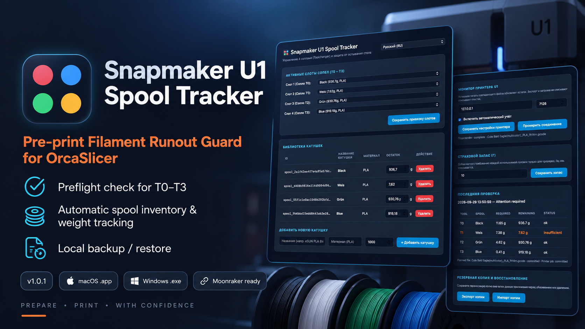

# Snapmaker U1 Spool Tracker

Track filament on the four U1 toolheads, compare spool balances with the estimated usage, and record how much each print used. Assign spools manually on stock U1 firmware. Spoolman is optional.

| Release | Downloads | Setup |
| --- | --- | --- |
| **1.3.3 stable** | [macOS Apple Silicon and Windows x64](https://github.com/gromvs75/snapmaker-u1-spool-tracker/releases/tag/v1.3.3) | [English](https://github.com/gromvs75/snapmaker-u1-spool-tracker/blob/v1.3.3/docs/guides/en.md) · [Русский](https://github.com/gromvs75/snapmaker-u1-spool-tracker/blob/v1.3.3/docs/guides/ru.md) |
| **2.1 beta** | [macOS Apple Silicon and Windows x64](https://github.com/gromvs75/snapmaker-u1-spool-tracker/releases/tag/v2.1.0-beta.1) | [English](https://github.com/gromvs75/snapmaker-u1-spool-tracker/releases/download/v2.1.0-beta.1/Tracker-2.1-Beta-Guide-EN.md) · [Русский](https://github.com/gromvs75/snapmaker-u1-spool-tracker/releases/download/v2.1.0-beta.1/Tracker-2.1-Beta-Guide-RU.md) |

## Print from your phone with 2.1 beta

Start a print from **Snapmaker Space** on your phone while Tracker is running and connected to the U1. Snapmaker Orca can be closed. **Keep the computer on and awake and leave Tracker running and connected until the print finishes.** Tracker reads the active G-code from the printer. When it can verify the job and the spool assignments, the used toolhead cards show estimated grams and the expected balance after printing. Check **History** after the job for recorded usage or a review request.

1. In Tracker, add the U1's local IP address and click **Connect printers**. Use port `7125` unless you changed it.
2. With the printer idle, add your spools and enter their remaining filament weight. In **Overview → Assignments**, match the installed spools to T0–T3 and click **Confirm positions**.
3. Keep the computer awake and connected, then start a short print from Space. Check the cards during printing and the balances afterward.

The macOS beta was tested on a real U1. In a four-toolhead print started from Snapmaker Space, Tracker recorded usage for all four spools. The Windows EXE passed simulator checks in WebView2. Real-printer testing of the Windows beta and third-party RFID tags is planned.

## Show plate numbers after slicing in Snapmaker Orca

For the beta's local slice forecast, edit the **printer preset**. In **Machine G-code → Machine start G-code**, add this comment above the existing code.

```gcode
; TRACKER_BED_V1 = {plate_number}
```

Save the preset, **select it in the current project**, and slice again. Check the selected preset after opening a 3MF because the project may bring its own printer settings. The post-processing field belongs to the process preset. Follow the guide for your Tracker version if you use an export script.

## Documentation and feedback

- [Spoolman setup for 1.3.3 in English](https://github.com/gromvs75/snapmaker-u1-spool-tracker/blob/v1.3.3/docs/guides/spoolman-en.md) · [На русском](https://github.com/gromvs75/snapmaker-u1-spool-tracker/blob/v1.3.3/docs/guides/spoolman-ru.md)
- [Developer guide](docs/development.md) · [Release history](https://github.com/gromvs75/snapmaker-u1-spool-tracker/releases) · [Report a problem](https://github.com/gromvs75/snapmaker-u1-spool-tracker/issues)

Source is in `src/`, tests in `tests/`, guides in `docs/`, packaging in `packaging/`, and simulators in `dev/`. The release tags identify the source for each package. [MIT license](LICENSE)


