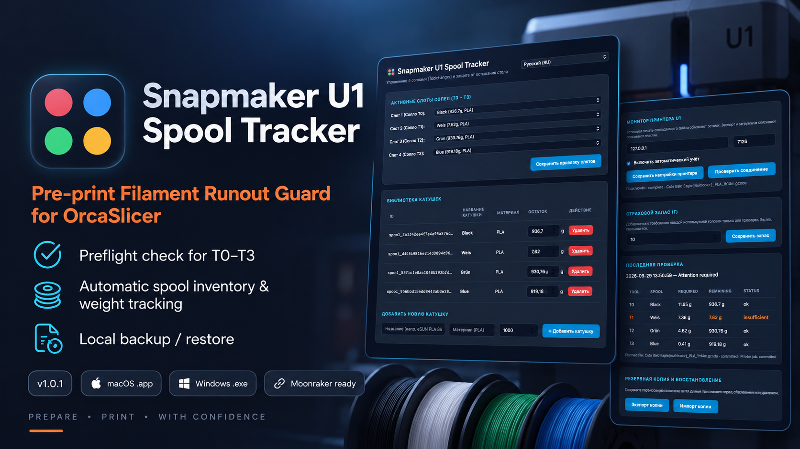

*Project banner shows an earlier interface. Current stable release: 1.3.3.*

# Snapmaker U1 Spool Tracker

**Local spool inventory and usage forecasts for Snapmaker U1, without firmware changes.**

Tracker watches completed Snorca slices and shows reserve-aware forecasts in the
menu bar/tray and dashboard. Slicing does not deduct filament or start printing.
Printer monitoring can account for verified jobs. Optional Spoolman integration
reads the catalog and sends confirmed usage after explicit configuration.

**[Download 1.3.3](https://github.com/gromvs75/snapmaker-u1-spool-tracker/releases/tag/v1.3.3)** —
Windows x64 and macOS Apple Silicon (arm64).

## What's new

Windows startup and tray fixes; consistent Settings and Spools navigation;
colored spool icons; Add and assign; manufacturer labels, live catalog search
and linked-name comparison for Spoolman.
[Release notes and known limitations](docs/releases/1.3.3.md).

## Setup and upgrade

Export a backup and quit the previous Tracker before replacing it. The existing
`SnapmakerSpoolTracker-Beta12` data directory is retained. Configure the Snorca
post-processing command for the installed app path and enable printer monitoring
for automatic accounting. A green forecast alone does not confirm accounting.

- [Русская инструкция](docs/guides/ru.md) · [English guide](docs/guides/en.md)
- [Spoolman: русский](docs/guides/spoolman-ru.md) · [English](docs/guides/spoolman-en.md)
- [Documentation](docs/README.md) · [Development](docs/development.md)

## Status and limitations

Windows users tested rc5 startup/exit, search, assignment and settings persistence.
Ordinary print accounting and Spoolman delivery were confirmed in the candidate
series. Other desktop/printer configurations still require validation.

Automatic replenishment and manual spool replacement during printing remain
experimental. Interrupted observation or inconsistent counters can leave a job
unaccounted; no usage is sent to Spoolman for that job. Keep the computer awake
and Tracker running. Forecasts and consumption are estimates, not measurements.
Forecast material mapping is assumed and labelled in the dashboard.

macOS builds are ad-hoc signed, not notarized. Windows requires WebView2 for the
native window. Spoolman is installed separately; integration was tested with 0.27.1.
Do not run multiple accounting instances for the same printer.

## Repository map

`src/` application · `tests/` checks · `dev/` simulators and development tools ·
`docs/` guides and release notes · `packaging/` desktop resources ·
`requirements/` dependency sets · `scripts/` build and launch helpers.

[MIT license](LICENSE) · [Spoolman attribution](docs/licenses/Spoolman-NOTICE.md).
No cloud account is required.
